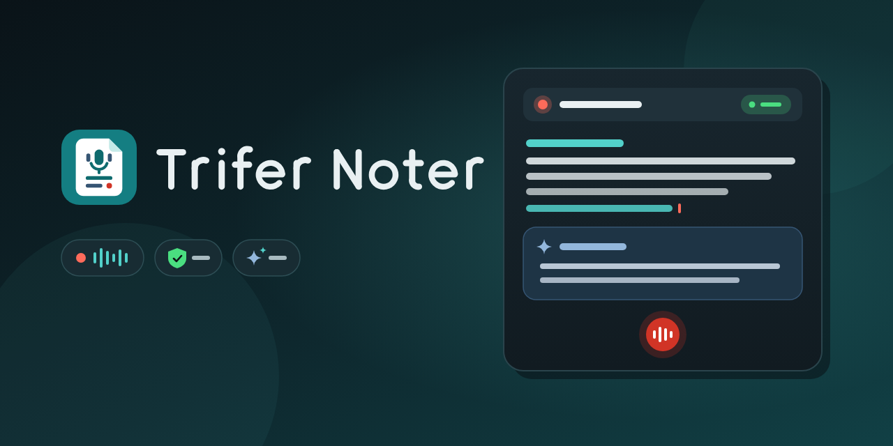

<div align="center">


# Trifer Noter

### Rekam rapat dan kuliahmu. Teksnya muncul saat itu juga.

Aplikasi Android gratis untuk **merekam dan mencatat rapat, kuliah, atau presentasi berbahasa Indonesia**.<br>
Transkripsi langsung (live) berjalan **di HP-mu sendiri, tanpa internet**.<br>
**Tanpa akun. Tanpa iklan. Tanpa pelacak.**

<p><i>Suaramu tetap di HP. Kirim ke AI hanya kalau kamu sendiri yang memilihnya.</i></p>


[](https://github.com/ICR-1/trifer-noter/releases/latest)

**[Bahasa Indonesia](#bahasa-indonesia)** · **[English](#english)** · **[Spesifikasi](#spesifikasi)** · **[Kredit](#kredit-dan-lisensi)**

<br>



</div>

<a id="bahasa-indonesia"></a>

## Catatan rapat tanpa mengetik

Untuk rapat kantor, kuliah dosen, dan presentasi yang terlalu cepat untuk dicatat. Tekan rekam, dan teks muncul saat orang bicara. Setelah selesai, kirim transkripnya ke aplikasi AI favoritmu untuk dirangkum.

| Yang kamu butuhkan | Yang dilakukan Trifer Noter |
| :--- | :--- |
| **🎙️ Rekam sampai 3 jam** | Rekaman berjalan di latar belakang dengan notifikasi, tetap aman walau layar mati. Bisa dijeda, dan ada penanda waktu. |
| **⚡ Teks langsung, tanpa internet** | Mesin suara berjalan di HP. Audio dan teksmu tidak dikirim ke mana pun. |
| **✨ Rapikan** | Setelah rekaman, satu ketukan menjalankan model Whisper untuk hasil lebih akurat, lengkap dengan tanda baca. |
| **📂 Impor file audio** | Punya rekaman dari aplikasi lain? Impor, dan aplikasi menyalinnya jadi teks seperti rekaman biasa. |
| **✏️ Koreksi seperlunya** | Ketuk satu kalimat untuk memperbaiki salah dengar. Koreksimu tidak tertimpa saat Rapikan dijalankan lagi. |
| **🤖 Kirim ke AI** | Pilih templat (ringkasan kuliah, notulen rapat, butir tindakan, perintah buatanmu sendiri, atau teks polos) dan kirim langsung ke aplikasi AI di HP-mu. Teks panjang dipecah otomatis. |

**Terdeteksi otomatis:** aplikasi mencari semua aplikasi di HP yang bisa menerima teks, lalu menandai mana yang AI (ChatGPT, Claude, Gemini, DeepSeek, Copilot, Meta AI, NotebookLM, dan sejenisnya). Aplikasi AI yang belum dikenali bisa kamu sematkan lewat **Lainnya…**

<a id="pasang"></a>

## Pasang

1. Unduh **`TriferNoter-1.0.apk`** dari [halaman rilis](https://github.com/ICR-1/trifer-noter/releases/latest).
2. Buka berkasnya. Android akan meminta izin **memasang dari sumber ini**, izinkan sekali untuk aplikasi yang kamu pakai membukanya.
3. Buka **Trifer Noter**, beri izin **mikrofon** dan **notifikasi**.
4. Unduh model suara sekali (±340 MB, sebaiknya lewat Wi-Fi). Sesudah itu semuanya berjalan offline.

<details>
<summary>Muncul peringatan "aplikasi tidak dikenal" atau Play Protect?</summary>

Aplikasi ini belum diterbitkan di Play Store, jadi Android memperlakukannya sebagai aplikasi dari luar toko. APK ditandatangani dengan kunci rilis Nousfercorp. Pastikan kamu mengunduhnya dari halaman rilis repositori ini, lalu pilih **Tetap pasang**.

</details>

### Cara pakai

1. **Rekam.** Ketuk tombol rekam di Beranda. Teks muncul langsung, dan kamu bisa menjeda atau memberi penanda.
2. **Selesai.** Ketuk berhenti. Catatan tersimpan dan bisa dibuka kapan saja, lengkap dengan pemutar audio.
3. **Rapikan (opsional).** Di layar catatan, jalankan **Rapikan** untuk hasil lebih akurat. Unduhan modelnya (±820 MB) hanya sekali.
4. **Kirim ke AI.** Ketuk **Kirim ke AI**, pilih templat, lalu pilih aplikasi AI yang terpasang.

<a id="spesifikasi"></a>

## Spesifikasi

| | |
| :--- | :--- |
| **Sistem** | Android 10 (API 29) atau lebih baru |
| **Prosesor** | ARM 64-bit (`arm64-v8a`). Perangkat 32-bit dan x86 tidak didukung |
| **Bahasa** | Indonesia |
| **Batas rekam** | 3 jam per rekaman |
| **Format audio** | WAV 16 kHz mono, ±115 MB per jam |
| **Transkripsi live** | Di perangkat, tanpa internet. Model ±340 MB diunduh sekali |
| **Rapikan** | Model Whisper ±820 MB diunduh sekali. Hanya muncul di HP dengan CPU yang mendukung |
| **Memori (RAM)** | Perkiraan ±1,2 GB untuk live, tambahan ±850 MB saat Rapikan. HP dengan RAM 4 GB atau kurang bisa tidak stabil |
| **Ruang simpan** | ±51 MB aplikasi, ±340 MB model live, ±820 MB model Rapikan, ditambah rekaman |
| **Izin** | Mikrofon, notifikasi, dan internet (hanya untuk mengunduh model) |
| **Diuji pada** | Samsung Galaxy S23 Ultra (SM-S918B). Perangkat lain belum diuji |

### Batasan yang perlu kamu tahu

- **Akurasi tergantung suara.** Kualitas mikrofon, jarak, dan kebisingan berpengaruh. Nama orang dan istilah asing sering salah dengar, jadi periksa bagian penting.
- Teks live memotong ucapan per jeda, sedangkan **Rapikan** memberi hasil lebih baik dengan tanda baca.
- Sesi sangat panjang membuat HP hangat dan menguras baterai. Uji beban penuh 3 jam di banyak perangkat **belum dilakukan**.
- Hasil transkripsi bisa memuat kesalahan. Jangan jadikan satu-satunya sumber untuk keputusan penting.

## Privasi

- Audio dan transkrip **diproses dan disimpan di HP ini**. Tidak ada akun, iklan, atau analitik.
- Internet hanya dipakai untuk **mengunduh model suara sekali** (dari Hugging Face).
- Data keluar dari aplikasi **hanya saat kamu memilih Kirim ke AI**. Setelah itu, data tunduk pada kebijakan aplikasi AI yang kamu pilih. Aplikasi menampilkan pengingat ini sebelum pengiriman pertama.
- Rekaman ditandai notifikasi dan indikator mikrofon, jadi aplikasi tidak merekam diam-diam. **Mintalah izin orang yang suaranya direkam.**

<a id="kredit-dan-lisensi"></a>

## Kredit dan lisensi

**Trifer Noter © 2026 Nousfercorp. Seluruh hak dilindungi.** Gratis dipakai, tetapi **hanya Nousfercorp yang berhak mengubah, menyalin, atau menyebarkan ulang** aplikasi ini. Teks lengkapnya ada di [`LICENSE`](LICENSE) dan di layar **Tentang** dalam aplikasi.

Dibangun di atas karya sumber terbuka berikut. Terima kasih kepada para pembuatnya.

| Komponen | Pembuat | Peran | Lisensi |
| :--- | :--- | :--- | :--- |
| [sherpa-onnx](https://github.com/k2-fsa/sherpa-onnx) | k2-fsa | Mesin transkripsi langsung | Apache-2.0 |
| PengChengStarling | PengCheng Lab | Model suara transkripsi langsung | Apache-2.0 |
| [ONNX Runtime](https://github.com/microsoft/onnxruntime) | Microsoft | Penjalan model di perangkat | MIT |
| [whisper.cpp](https://github.com/ggml-org/whisper.cpp) | Georgi Gerganov dan kontributor ggml | Mesin untuk Rapikan | MIT |
| [Whisper](https://github.com/openai/whisper) | OpenAI | Model suara untuk Rapikan | MIT |
| Android Jetpack | The Android Open Source Project | Tampilan, penyimpanan, navigasi | Apache-2.0 |
| Kotlin dan Coroutines | JetBrains | Bahasa dan pemrosesan latar | Apache-2.0 |

Komponen di atas tetap berada di bawah lisensinya masing-masing. Teks lisensinya dapat dibaca di dalam aplikasi, di bawah **Tentang → Lihat teks lisensi**.

## Untuk pengembang

Repositori ini privat dan berhak cipta penuh. Berikut catatan membangunnya untuk pemilik dan pihak yang diberi izin tertulis.

- Android Studio (memakai JDK bawaannya), compileSdk 37, minSdk 29, target 36
- NDK 28.2 dan CMake 3.22.1 (whisper.cpp dibangun di dalam aplikasi, hanya `arm64-v8a`)

```bash
# Windows (PowerShell): pakai JDK bawaan Android Studio
$env:JAVA_HOME = "C:\Program Files\Android\Android Studio\jbr"
./gradlew.bat :app:testDebugUnitTest :app:assembleDebug

# Build rilis (butuh keystore.properties lokal, tidak ikut repositori)
./gradlew.bat :app:assembleRelease :app:bundleRelease
```

Dokumen lain: [`docs/benchmark.md`](docs/benchmark.md) (pemilihan mesin suara), [`docs/play-store-checklist.md`](docs/play-store-checklist.md) (kesiapan Play Store).

---

<a id="english"></a>

## English

**Trifer Noter** is a free Android app that records meetings, lectures and presentations in **Indonesian** and transcribes them **live, on your device, offline**. When you are done, send the transcript to the AI app of your choice for a summary. No account, no ads, no trackers.

- **Record up to 3 hours** with a foreground notification, pause and bookmarks.
- **Live on-device transcription** (sherpa-onnx). Audio and text never leave your phone.
- **Refine** with a local Whisper model for better accuracy and punctuation.
- **Import audio files**, **edit** any sentence, and **send to AI** with templates. AI apps installed on your phone are detected automatically.

**Requirements:** Android 10+, 64-bit ARM, about 1.2 GB of free RAM for live transcription, and roughly 1.2 GB of storage for models (downloaded once). Verified only on the Samsung Galaxy S23 Ultra (SM-S918B).

**Install:** download the APK from the [latest release](https://github.com/ICR-1/trifer-noter/releases/latest), allow installing from this source, and download the voice model on first launch (about 340 MB).

**License:** Copyright © 2026 Nousfercorp. All rights reserved. Free to use; only Nousfercorp may modify or redistribute it. Third-party components remain under their own licenses (see the table above).

---

<div align="center">
<sub>Dibuat oleh <b>Nousfercorp</b></sub>
</div>
